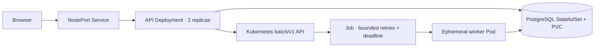

# Dispatch · Kubernetes job platform

A report factory that gives Kubernetes a useful job: run bounded, retryable batch
work while a small API remains independently deployable. Reports aggregate 10,000
generated sales lines. No private data, vendor accounts, or paid cloud is required.



The UI is at **http://localhost:8095**. Kubernetes controls execution; PostgreSQL
retains accepted intent and results. Finished Jobs expire after five minutes.

## Run locally

Requires Docker with Linux containers, Python 3.12+, and `kubectl` on PATH
(1.36–1.38 for this pinned 1.37 server). Docker Desktop may need its CLI directory
added to your terminal's PATH. Budget roughly 3 GiB of free Docker memory for the
single-node lab and build. Port 8095 must be free.

```sh
python scripts/lab.py up
python scripts/lab.py status
python scripts/verify.py
```

The launcher downloads kind v0.33.0 from its official release and verifies its
published SHA-256 checksum. It creates only `dispatch-lab`, writes kubeconfig to
ignored `.local/kubeconfig`, and explicitly selects that file and context for
every kubectl operation. It never switches your global Kubernetes context.
The node image is pinned by digest. A database secret is randomly generated and
sent to kubectl on stdin; it is not saved in source or printed.

Run `up` again to rebuild and roll out code; it preserves the database password
and PVC. For a scoped kubectl command:

```sh
python scripts/lab.py kubectl get jobs
python scripts/lab.py kubectl logs deployment/api
```

**Destructive cleanup:** `python scripts/lab.py down` deletes this named kind
cluster, including its database volume and reports. Other clusters stay intact.

## What this demonstrates

| Concern | Working implementation |
|---|---|
| Batch scheduling | Native Jobs; fixed application image and command, never caller-supplied code |
| Retry and termination | One retry, 80-second active deadline, 300-second finished-Job TTL |
| Durable dispatch | Persisted request before Job creation, periodic reconciliation, deterministic Job names |
| Duplicate work | Submission idempotency; per-report PostgreSQL session lock; one result row |
| Availability | Two API replicas, startup/readiness/liveness probes, rolling strategy, disruption budget |
| Scaling | Manual replica changes with actual readiness verification |
| Persistence | PostgreSQL StatefulSet with a PVC; results outlive worker and database Pod replacement |
| Cluster permissions | Namespace Role permits only Job create/get; workers have no service-account token |
| Workload controls | Restricted Pod Security admission, nonroot/read-only containers, requests/limits, quota |
| Verification | Unit contracts plus real cluster retry, recovery, RBAC, scaling, eviction and rollout checks |

## Read and demonstrate

- [Architecture and tradeoffs](docs/architecture.md)
- [Operator runbook](docs/runbook.md)
- [Five-minute interview walkthrough](docs/walkthrough.md)
- [Recorded verification](docs/verification.json)

Local checks require only the dev dependencies, separate from the image:

```sh
uv sync --locked --extra test
uv run --locked --extra test pytest
```

This is a local platform study, not a production cluster. One node and one
database remain shared failure domains. No HPA, service mesh, external ingress,
cloud IAM, backup service, or network isolation is claimed. See the architecture
for the boundaries and the next steps justified by a real workload.
